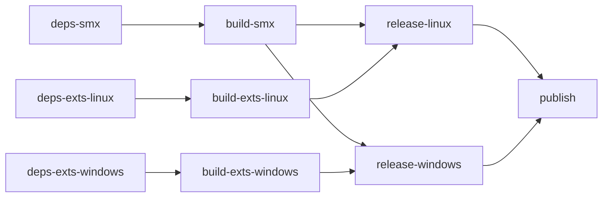

# Build y CI/CD

[Índice](index.md) · [Núcleo nativo](native-core/index.md)

`make` es la entrada común. SourcePawn usa los scripts Python existentes y la
extensión usa AMBuild (`configure.py`, `AMBuildScript`, `extension/AMBuilder` y
`PackageScript`), adaptados de Custom-Fakelag `b871f52`. No hay CMake/Meson ni
compilación implícita al empaquetar.

## Linux x86

Requiere Python 3.12, git, make, g++ con multilib (`g++-multilib` en Ubuntu) y venv.
Los comandos de dependencias son los únicos que usan red:

```sh
make deps-smx deps-exts-linux
make build-smx build-api-test build-exts-linux
make test-exts-linux test-ci
python3 scripts/run-native-tests.py --platform linux --sanitize
make package-smx package-exts-linux
make release-linux validate-artifact
```

El build SourcePawn siempre usa `-E`. La extensión usa C++14, `-m32`, optimización,
visibilidad oculta y warnings fatales; el script registra la salida completa y
propaga cualquier error. Las pruebas unitarias ordinarias usan x86. Sanitizadores
sobre servicio aislado usan la arquitectura del host y no validan el ABI del juego.
`AbiChecks.cpp` forma parte de la extensión x86 y valida la firma SDK.

## Windows x86

Requiere Python 3.12, git, make y una terminal de MSVC inicializada para x86. CI usa
`scripts/setup-msvc.py`: localiza Visual Studio con `vswhere`, ejecuta el
`vcvarsall.bat x86` instalado y exporta los cambios a `GITHUB_ENV` para los pasos
siguientes. No depende de una acción JavaScript para inicializar MSVC.
No se declara soporte de cross-build desde Linux.

```sh
make deps-exts-windows PYTHON=python
make build-exts-windows test-exts-windows PYTHON=python
make package-exts-windows PYTHON=python
make release-windows validate-artifact PLATFORM=windows PYTHON=python
```

El paquete SMX compartido se obtiene del job Linux o se copia como árbol existente
a `.build/package-smx`; no hace falta recompilarlo en Windows. `subprocess` con
`check=True` propaga fallos del compilador, configure, AMBuild, tests y git. No hay
un wrapper PowerShell que pueda ocultar errores de procesos externos.

## Dependencias y salidas

| Dominio | Dependencias | Build | Staging |
| --- | --- | --- | --- |
| SMX compartido | .deps/smx/sourcemod-linux | .build/smx | .build/package-smx |
| Extensión Linux x86 | .deps/exts-linux | .build/exts-linux | .build/package-exts-linux |
| Extensión Windows x86 | .deps/exts-windows | .build/exts-windows | .build/package-exts-windows |

Las dependencias nativas tienen commits fijados en `dependencies.lock.json`, con
submódulos fijados por esos repositorios. `resolved.json` registra la resolución.
No se actualiza una copia de dependencia sucia. SourcePawn usa el paquete
1.12.0.7255 fijado por URL/SHA256; la caché requiere su marcador de verificación.
Un destino antiguo no verificado exige elegir un destino limpio, no se reemplaza.

Se conservan `SPCOMP`, `SM_SCRIPTING`, `SMX_BUILD_DIR`, `SMX_PACKAGE_DIR`,
`SOURCEMOD_VERSION`/`SM_VERSION` (rama compatible 1.12) y `RELEASE_BASENAME`.
Los overrides nativos son `EXTS_LINUX_DEPS_DIR`, `EXTS_WINDOWS_DEPS_DIR`,
`LINUX_BUILD_DIR`, `WINDOWS_BUILD_DIR`, `EXTS_PACKAGE_LINUX_DIR`,
`EXTS_PACKAGE_WINDOWS_DIR`, `LINUX_RELEASE_BASENAME` y `WINDOWS_RELEASE_BASENAME`.
Los outputs deben estar dentro de `.build`/`dist`; no se limpia el checkout.
El build SourcePawn antiguo continúa disponible con `SPCOMP=deps/sourcemod-linux/
addons/sourcemod/scripting/spcomp64`; el directorio antiguo no es el default.

`make release` conserva un alias local: empaqueta las salidas existentes de SMX y
Linux y ejecuta `release-linux` solo después de completar ambos paquetes. Esta
dependencia también se respeta con `make -j3 release`; si falla un staging no se
inicia la fusión. Ya no genera un ZIP ambiguo sin plataforma.
`make clean` llama a ambas limpiezas de plataforma; estas conservan los outputs
SMX compartidos y los ZIP existentes, evitando borrar el trabajo concurrente de
la otra plataforma. Se pueden retirar manualmente esos compartidos cuando no haya
builds en curso. Ningún target de package/release descarga un SDK ni recompila.

## Manifiesto y contenido de paquetes

`build.plugins` selecciona únicamente `l4d2_speedwatch.sp` como entrypoint.
`build.extensions` declara únicamente `l4d2_speedwatch_core`. Los módulos privados
se incluyen dentro del SMX y no se compilan como plugins independientes. Los tests
antiguos y nativo se compilan mediante `build-api-test` y nunca se distribuyen.

Cada ZIP contiene un SMX, una extensión de su plataforma, fuentes SourcePawn
permitidas, ambos includes públicos, traducciones, LICENSE, `compile.log`,
`native-compile.log`, `sourcepawn-build-info.json` y `build-info.json`. Los metadatos
registran SHA, dependencias, compiladores, inputs y hashes de binarios/payload.
No se exige `.so` y `.dll` juntos. Gamedata propia no se añade: se necesita la
`PlayerRunCmd` de SDKTools instalada con SourceMod. Quedan excluidos docs, README,
SDKs, tests, harnesses, includes de terceros y binarios del juego.

El empaquetado valida ELF32/PE32 x86, exports `GetSMExtAPI` y `CreateInterface_MMS`,
archivos faltantes/vacíos/no permitidos, duplicados de plataforma y hashes. Un
cambio de inputs impide presentar un binario antiguo como build de las fuentes
actuales. Las pruebas de empaquetado usan fixtures explícitos, no binarios reales
del juego. El archivo de metadata no es una firma criptográfica de autenticidad.

## Canales CI

El workflow adopta el grafo de Custom-Fakelag revisado en
`2ce01ff9010a93314cbe734154d2dbd40f25ee03`, adaptado a los paths, validaciones y
locks de SpeedWatch. Son nueve jobs explícitos:



Los jobs de dependencias restauran o generan y guardan una caché, y publican su
clave exacta. Los builds requieren esa caché (`fail-on-cache-miss`), sin volver a
ejecutar targets de descarga. Las cachés se separan por plataforma/arquitectura y
hash de los locks y scripts de resolución. Las cachés nativas incluyen también la
versión resuelta de Python para no reutilizar un venv de otro intérprete. Todos
los jobs Python usan 3.12.

`build-smx` compila el plugin una sola vez, los consumidores de API y las pruebas
Python. Entrega `.build/smx` y el log `.build/smx-compile.log` en artefactos
separados. Cada build nativo ejecuta las pruebas y compila su extensión; Linux
conserva además sanitizadores del servicio aislado en la arquitectura del host.
Windows inicializa MSVC x86 mediante `setup-msvc.py`, sin la acción Node.js 20.

Cada build nativo entrega solo `package/`, `build-info.json` y `compile.log`,
con raíz común `.build/exts-<plataforma>`; no transmite objetos ni el SDK. Los jobs
de release reconstruyen esas rutas junto al SMX/log y ejecutan los mismos targets
`package-smx`, `package-exts-<plataforma>`, `release-<plataforma>` y
`validate-artifact` de Make. Linux empaqueta en Ubuntu y Windows en Windows 2022,
sin descargar SDK ni recompilar. Una única invocación de Make para los dos
stagings propaga fallos también bajo PowerShell.

Solo `publish`, después de ambas releases, tiene permiso de escritura. Descarga
los dos ZIP por nombre exacto y usa GitHub CLI para crear/actualizar el canal y
subir ambos assets con `--clobber`, siguiendo Custom-Fakelag. Conserva
`channel/latest` para main y `channel/develop` como prerelease para develop.
Los PR producen artefactos sin tags/releases ni secretos para código de forks.
Los assets son `l4d2-speedwatch-linux-latest.zip`,
`l4d2-speedwatch-windows-latest.zip` y sus equivalentes `-develop` o `-pr-<sha>`.
El antiguo asset sin plataforma no se vuelve a generar. Los permisos son de
lectura por defecto; el filtro de paths de PR y las comprobaciones de SpeedWatch
se conservan. La adaptación local del workflow no acredita una ejecución remota.
